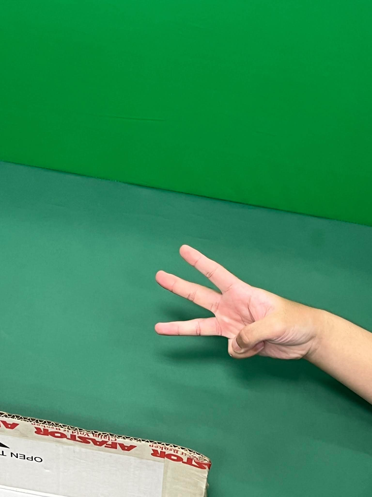
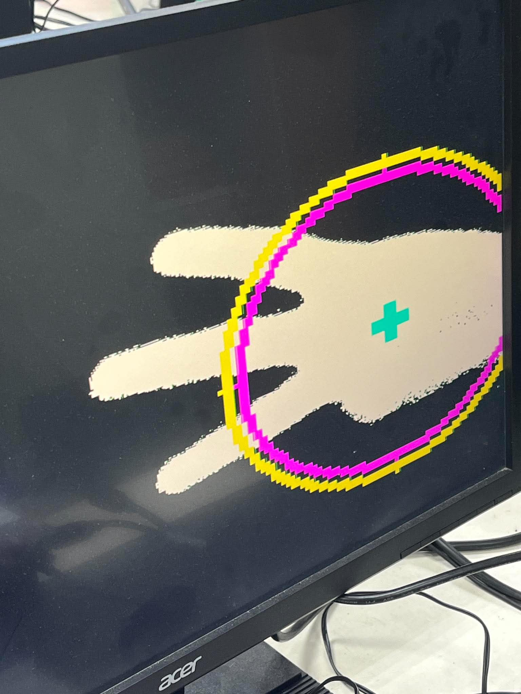
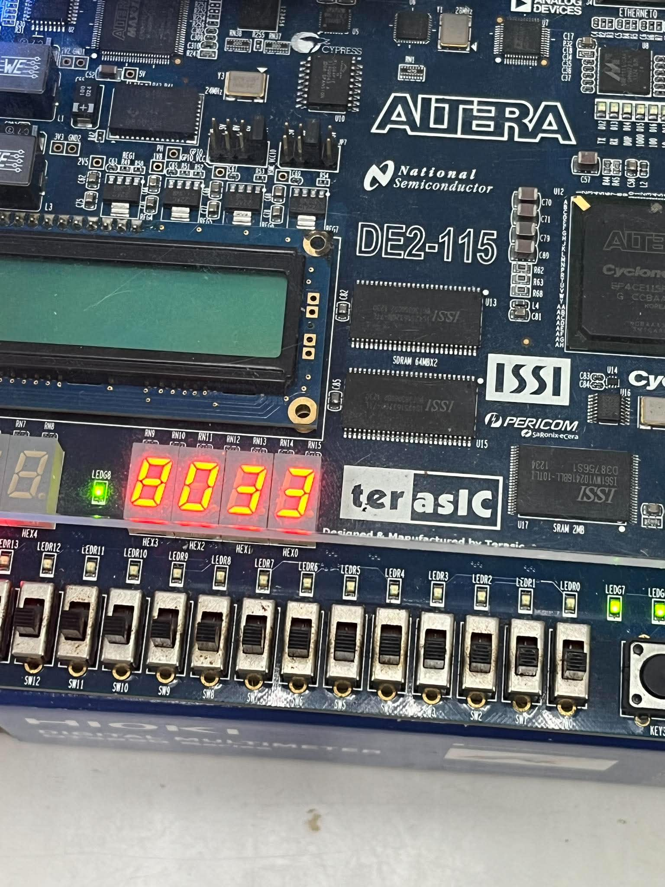
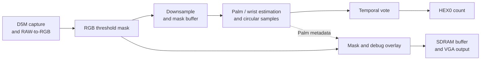

# FPGA Finger Counting on the DE2-115

A Verilog finger-counting system built on a Terasic DE2-115 FPGA board with a TRDB-D5M camera. The system extracts a hand mask, estimates the palm and wrist, and counts finger candidates using circular samples around the palm. A VGA monitor shows the analysis overlay, while the board displays the stabilized count.

My teammate and I developed this undergraduate capstone to practice RTL design and test an image-processing system on hardware. Our work focused on the hand-analysis path and its integration with the camera, display, and board controls.

**Start here:** [Hardware demonstration](#hardware-demonstration) · [How it works](#how-it-works) · [Implementation decisions](#implementation-decisions) · [Build and run](#build-and-run) · [Project report](docs/PROJECT_SUMMARY.md)

## Hardware demonstration

We demonstrated finger counts from **0 to 5** with one hand against a green-cloth background. The example below shows a three-finger gesture, its processed mask, and the board output.

| Hand gesture | VGA mask and analysis overlay | FPGA board output |
| --- | --- | --- |
|  |  |  |

On the monitor, white pixels form the hand mask, the cyan cross marks the estimated palm center, and the magenta/yellow circles show the acceptance radii. **HEX0, the rightmost seven-segment display, shows the count.** The other lit digits are diagnostics.

See [all 0–5 examples and testing notes](docs/VALIDATION.md). These photographs document a functional demonstration under the reported setup. We did not record repeated-trial accuracy, frame rate, or latency, and the closed-fist/zero case sometimes produced an incorrect count.

## Project at a glance

| Item | Implementation |
| --- | --- |
| Board | Terasic DE2-115 |
| FPGA | Cyclone IV E `EP4CE115F29C7` |
| Camera | Terasic TRDB-D5M |
| Design language | Verilog |
| Camera processing mode | 800 × 600 |
| Analysis mask | 160 × 120; one sample every five pixels in both directions |
| Analysis clock | 50 MHz on `CLOCK2_50` |
| Counting method | Integer distance transform and multi-radius arc analysis |
| Output | Stabilized 0–5 count; `E` when no reliable stabilized result is available |
| Development tools | Quartus Prime Lite 18.1 |

The analysis clock is the RTL processing clock; it is not a measured frame rate.

## How it works



1. **Extract the hand mask.** RGB thresholds select foreground pixels. The analysis path samples the 800 × 600 input into a 160 × 120 binary mask.
2. **Estimate the palm.** A forward/backward 3/4 chamfer distance transform estimates the distance from foreground pixels to the background. A maximum-distance point in the central search region gives the palm-center estimate and radius `R`.
3. **Locate the wrist.** Foreground contact with an image edge provides a wrist-entry estimate.
4. **Find finger candidates.** The analyzer samples 128 directions on circles at 2R, 1.875R, and 1.5R. It removes the connected wrist arc and filters the remaining foreground arcs. Only candidates reaching the 2R or 1.875R circles can add to the count; matching candidates across rings are merged.
5. **Stabilize the output.** Temporal voting uses an eight-analysis window with a five-vote acceptance threshold. The raw count and stabilized output are available separately for debugging.

Detailed parameters, assumptions, and module connections are in [ARCHITECTURE.md](docs/ARCHITECTURE.md).

## Implementation decisions

### Make the mask visible during debugging

The counting result depends on the quality of the binary mask. Background objects and changes in lighting could pass the thresholds or remove parts of the hand.

We used a fixed green background during hardware testing and exposed the mask on the VGA monitor. This let us inspect segmentation separately from the later palm and counting steps. The setup helped us demonstrate the system, while also showing why broader background and lighting tests are still needed.

The threshold logic is in [skin_detect.v](hand_detection/skin_detect.v).

### Separate the wrist from finger candidates

The wrist could appear as another foreground arc and increase the count. The analyzer uses edge contact to estimate the wrist direction, locates a foreground seed near that direction, and removes the connected wrist arc from each sampled ring.

This approach follows the connected silhouette instead of excluding only a fixed angular window. The remaining arcs are filtered by width and merged across rings to reduce duplicate candidates.

The geometry and counting logic is in [hand_distance_circle.v](hand_detection/hand_distance_circle.v), with directions supplied by [hand_angle_lut.v](hand_detection/hand_angle_lut.v).

### Preserve complete masks across clock domains

Camera capture and analysis operate in different clock domains. The mask buffer checks sample order and completeness, then uses a request/acknowledge handshake to transfer ownership of a completed mask bank.

When analysis cannot accept another frame, capture can discard a whole frame. A separate mailbox transfers analysis metadata back to the camera domain for the overlay. Reset release is synchronized within each domain.

See [hand_mask_buffer.v](hand_detection/hand_mask_buffer.v), [hand_debug_mailbox.v](hand_detection/hand_debug_mailbox.v), and [hand_reset_sync.v](hand_detection/hand_reset_sync.v).

## Build and run

### Requirements

- DE2-115 board and TRDB-D5M camera.
- VGA monitor and cable.
- USB-Blaster connection and board power.
- Quartus Prime Lite 18.1 with Cyclone IV device support.
- PowerShell for the optional build command.

### Compile

Open `DE2_115_CAMERA.qpf` in Quartus. Confirm the top-level entity is `DE2_115_CAMERA` and the device is `EP4CE115F29C7`, then select **Processing → Start Compilation**.

Alternatively, run the existing build script from the repository root:

```powershell
.\build.ps1 -QuartusRoot C:\intelFPGA_lite\18.1\quartus
```

Adjust the Quartus installation path to match your computer. The script writes a build log and checks the reported timing-summary slack.

### Program and inspect

1. Connect the camera and VGA monitor according to the [setup guide](docs/SETUP.md).
2. Set the board's RUN/PROG switch to RUN.
3. In Quartus Programmer, select the connected USB-Blaster and the newly generated `output_files/DE2_115_CAMERA.sof`.
4. Program the board and press KEY0 to reset and start capture.
5. Begin with one hand against a green background. Keep the palm near the center, leave gaps between extended fingers, and let the arm enter through an image edge.

| Control or output | Function |
| --- | --- |
| SW17 off | Color camera image |
| SW17 on, SW15 off | Binary hand mask |
| SW17 on, SW15 on | Mask with palm-center and acceptance-circle overlay |
| SW14 on | Enable HEX1–HEX3 diagnostics |
| HEX0 | Stabilized count, or `E` when unreliable |
| HEX1 / HEX2 / HEX3 | Raw count / error code / vote support |
| KEY0 | Reset |

Start by checking the mask, then the palm marker and circles, and finally the count. Full controls and error-code definitions are in [SETUP.md](docs/SETUP.md).

## Results and current limits

### Hardware results

The saved examples cover gestures from 0 to 5. They show the hand pose, monitor view, and board display for each example; the three photographs of a gesture are not separate test trials.

Observed difficulties include:

- Occasional errors for a closed fist or zero-finger gesture.
- Incorrect counts when the hand is too close to the camera.
- Segmentation changes caused by lighting, skin color, and background objects.
- Touching, occluded, or insufficiently extended fingers producing ambiguous arcs.

Temporal voting reduces fluctuation but cannot correct a consistently wrong mask or geometric interpretation. The photos are historical demonstration evidence and do not identify the exact source revision programmed on the board.

### Supplied FPGA build reports

| Resource | Reported use |
| --- | ---: |
| Logic elements | 8,002 / 114,480 (7%) |
| Dedicated logic registers | 2,823 |
| Memory bits | 249,400 / 3,981,312 (6%) |
| Embedded 9-bit multiplier elements | 21 / 532 (4%) |

These values come from the supplied [Fitter summary](docs/evidence/fitter_supplied.summary), produced with Quartus Prime Lite 18.1. They describe that recorded build; compilation was not rerun to prepare this README.

External camera, SDRAM, and VGA I/O timing remains incompletely constrained. The supplied internal timing results do not establish complete board-level timing closure. See [VALIDATION.md](docs/VALIDATION.md) for the report context.

## Repository guide

| Location | Contents |
| --- | --- |
| [DE2_115_CAMERA.v](DE2_115_CAMERA.v) | Top-level camera, analysis, display, and board integration |
| [hand_detection/](hand_detection/) | Mask capture, palm/wrist analysis, counting, voting, and overlays |
| [v/](v/) | Camera, RGB, VGA, I2C, and generated IP support |
| [Sdram_Control/](Sdram_Control/) | SDRAM controller and FIFO support |
| [DE2_115_HAND.sdc](DE2_115_HAND.sdc) | Timing constraints |
| [build.ps1](build.ps1) | FPGA build command |
| [docs/PROJECT_SUMMARY.md](docs/PROJECT_SUMMARY.md) | Project goal, problems encountered, and reflections |
| [docs/ARCHITECTURE.md](docs/ARCHITECTURE.md) | Algorithm, parameters, clock domains, and source reading order |
| [docs/VALIDATION.md](docs/VALIDATION.md) | Complete photo examples, limitations, and build evidence |
| [docs/SETUP.md](docs/SETUP.md) | Hardware setup, programming, switches, and debugging |

## Team and source attribution

This capstone was developed jointly by two students, with most work carried out together. The hand-analysis path and system integration are presented as shared team work; see [AUTHORS.md](docs/AUTHORS.md).

The camera, VGA, SDRAM, and generated IP infrastructure includes inherited Terasic/Altera material. Original notices are retained, and component provenance is recorded in [THIRD_PARTY_NOTICES.md](THIRD_PARTY_NOTICES.md). No repository-wide open-source license has been selected.

## Further work

- Record repeated trials for each count, including failed and invalid results, under a defined camera distance and lighting setup.
- Investigate near-camera and zero-count failures by comparing the mask, palm estimate, and sampled arcs.
- Measure analysis time and stabilized-output response time separately.
- Tie future photos and build reports to a source revision, and complete the external I/O timing constraints.
